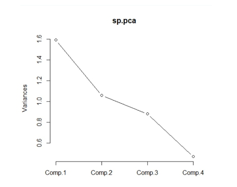

# Data Reduction and Big Data Using PCA on Superstore Dataset

## Project Overview
This project applies Principal Component Analysis (PCA) to the Superstore Dataset, which contains 9,994 observations and 21 variables from Kaggle. In big data, retail businesses face challenges with redundant and correlated data. PCA is used to reduce dimensionality by converting correlated variables into fewer uncorrelated principal components while retaining most information. For this analysis, 4 key numerical variables were selected: Sales, Quantity, Discount, and Profit to identify main factors influencing sales performance.

## Objectives
- To apply PCA to reduce the dimensionality from 4 variables to fewer principal components.
- To determine the number of principal components to retain using Eigenvalue Analysis and Kaiser Criterion (Eigenvalue > 1).
- To visualize PCA results using Scree Plot and Score Plot.
- To provide business implications for retail decision making.

## Tools & Technologies
- **Language:** R 4.6.0
- **IDE:** RStudio
- **Main Function:** `princomp(cor = TRUE)` using correlation matrix
- **Analysis Techniques:** Eigenvalue Analysis, Cumulative Variance, Component Loadings, Scree Plot, PCA Score Plot
- **Dataset:** Superstore Sales Dataset (Kaggle) - No missing values or duplicates

## Project Files
```
.gitignore
README.md 
project-report.pdf
r-analysis-results.txt
scree-plot.png
```

## Visualizations & Analysis

### 1. Scree Plot - Eigenvalue Analysis

<p align="center">
  
</p>

**Explanation:** The scree plot displays eigenvalues: PC1=1.589, PC2=1.058, PC3=0.881, PC4=0.469. While Kaiser criterion (eigenvalue >1) suggests 2 components, the cumulative variance criterion (>80%) is adopted for business decision-making. Two components retain only 66.22%, which is below the 80% industry standard. Retaining three components achieves 88.25%, providing a more comprehensive representation with minimal information loss.

### 2. Cumulative Variance Analysis

| Component | Eigenvalue | Variance (%) | Cumulative (%) | Decision |
| :--- | :--- | :--- | :--- | :--- |
| PC1 | 1.589 | 39.75% | 39.75% | Retain |
| PC2 | 1.058 | 26.47% | 66.22% | Retain |
| PC3 | 0.881 | 22.03% | **88.25%** | **Retain** |
| PC4 | 0.469 | 11.75% | 100% | Drop |

**Explanation:** Three principal components are retained to achieve 88.25% cumulative variance, exceeding the 80% threshold commonly used in retail analytics. This reduces four original variables into three components while preserving majority of information with only 11.75% loss.

### 3. Component Loadings

| Variable | PC1 (39.75%) | PC2 (26.47%) | PC3 (22.03%) |
| :--- | :--- | :--- | :--- |
| Sales | **0.643** | 0.218 | 0.306 |
| Quantity | 0.289 | **0.631** | **-0.701** |
| Discount | -0.270 | **0.719** | **0.592** |
| Profit | **0.655** | -0.195 | 0.253 |

**Interpretation:**
- **PC1 - Revenue Performance:** Driven by Sales (0.643) and Profit (0.655). Represents core revenue generation.
- **PC2 - Promotional Bulk:** Driven by Discount (0.719) and Quantity (0.631). Represents volume driven by promotions.
- **PC3 - Margin Trade-off:** High Discount (0.592) with negative Quantity (-0.701). Captures the risk where excessive discounting fails to increase quantity and erodes profitability.

### 4. Business Insight

By retaining 88.25% variance with 3 components instead of 66.22% with 2:

- **Simplified Monitoring:** Management can track 3 strategic dimensions (Revenue, Bulk Promo, Margin Risk) instead of 4 raw metrics.
- **Promotional Strategy:** Discount increases quantity (PC2), but PC3 reveals a threshold where further discounting reduces quantity, indicating potential quality perception issues or margin erosion.
- **Optimized Decision:** Balance discount levels to maximize PC1 and PC2 while minimizing negative impact from PC3.
